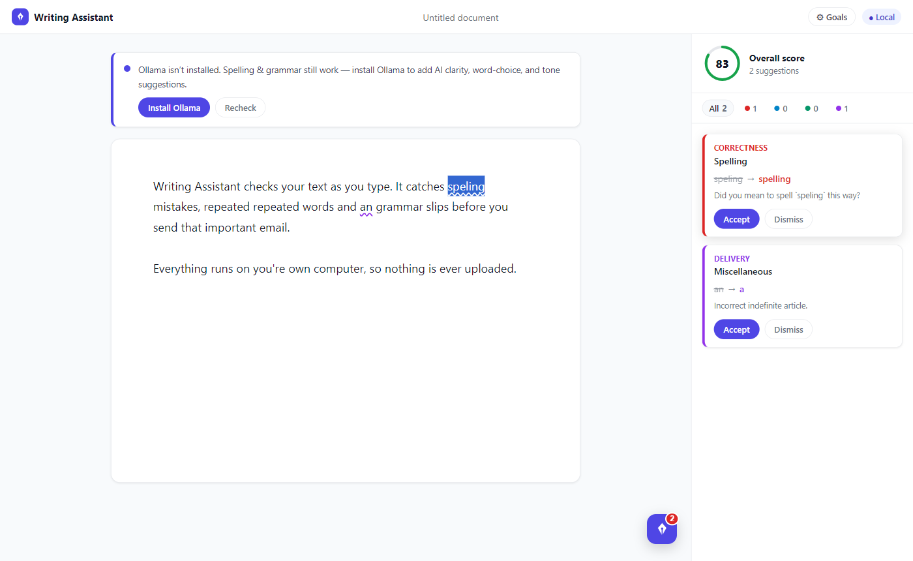

<p align="center">
  
</p>

<h1 align="center">Writing Assistant</h1>

<p align="center">
  <b>Private, offline grammar, spelling and style checker for Windows.</b><br>
  Your text never leaves your computer — no account, no subscription, no cloud.
</p>

<p align="center">
  <a href="https://github.com/stepan4002/writing-assistant/actions/workflows/ci.yml"></a>
  <a href="https://github.com/stepan4002/writing-assistant/releases/latest"></a>
  <a href="LICENSE"></a>
  
  
</p>

<p align="center">
  
</p>

---

## ⚡ Install in one line

Open **PowerShell** and paste:

```powershell
irm https://raw.githubusercontent.com/stepan4002/writing-assistant/main/install.ps1 | iex
```

It installs for your user only (no admin rights) and starts the app. Or download
**[WritingAssistant-Setup.exe](https://github.com/stepan4002/writing-assistant/releases/latest/download/WritingAssistant-Setup.exe)**
and run it. Windows SmartScreen may warn because the installer isn't code-signed yet: click **More info → Run anyway**.

<sub>Want to read it first? <a href="install.ps1"><code>install.ps1</code></a> is ~80 lines. Every release installer is <a href=".github/workflows/release.yml">built by GitHub Actions</a> from the tagged source.</sub>

## ✨ What it does

Paste or type your text and get suggestions in four categories, each with its own underline color:

| | Category | Examples | Engine |
|---|---|---|---|
| 🔴 | **Correctness** | spelling, grammar, punctuation | built-in, always on |
| 🔵 | **Clarity** | wordy or convoluted sentences | optional local AI |
| 🟢 | **Engagement** | bland or repetitive word choice | optional local AI |
| 🟣 | **Delivery** | tone, formality, politeness, plus minor style fixes from the built-in engine | optional local AI + built-in |

- Click an underline or a card to see the fix, then **Accept** or **Dismiss** it. Dismissed suggestions stay dismissed.
- A live **0–100 writing score** that accounts for the length of your text.
- **Goals** (audience, formality, domain) tune the AI suggestions.
- Your last document is restored when you reopen the app.

## 🧠 How it works — two local engines

| Tier | Engine | Needs |
|---|---|---|
| 1 | **[harper.js](https://github.com/Automattic/harper)**: a Rust grammar checker compiled to WebAssembly and embedded in the app | nothing: works instantly, offline, on every keystroke |
| 2 | **[Ollama](https://ollama.com)** running a small local model (default `llama3.2:3b`, ~2 GB) | optional; the app detects Ollama, offers to start it and can download the model for you |

Without Ollama the app still fully works for spelling and grammar. With Ollama, style
suggestions are merged in. Correctness suggestions always take precedence where the two engines overlap.

## 🔒 Privacy

- The grammar engine runs **inside the app** (WebAssembly). There is no server.
- AI suggestions go only to Ollama on **`127.0.0.1`**. The app refuses `*-cloud` model tags, so text can't be routed to a hosted model by mistake.
- A strict Content-Security-Policy blocks every remote resource. The app makes no telemetry or analytics calls.
- Note: Ollama itself may check for its own updates. That is separate from your text.

## 🆚 Compared with cloud writing assistants

| | Cloud writing assistants | Writing Assistant |
|---|---|---|
| Price | free tier, then subscription | **free, MIT-licensed** |
| Works offline | ❌ | ✅ |
| Your text is uploaded | yes | **never** |
| Works inside other apps (browser, Word…) | ✅ | ❌: standalone editor (paste, fix, copy back) |
| Languages | many | English |

Writing Assistant is an independent open-source project. It is not affiliated with Grammarly, Inc. or any other writing-assistant vendor.

## 🛠️ Build from source

Requires **Node.js 20+**.

```bash
git clone https://github.com/stepan4002/writing-assistant.git
cd writing-assistant
npm ci
npm run dev        # run with hot reload
npm test           # unit tests (vitest)
npm run typecheck  # tsc for main + renderer
npm run dist       # Windows installer -> releases/<version>/WritingAssistant-Setup.exe
```

`scripts/smoke-test.cjs` is an end-to-end check of the real app. It needs the `playwright`
npm package (`npm i -D playwright`) and drives Electron directly, so no browser download is required.

**Stack:** Electron · electron-vite · React + TypeScript · CodeMirror 6 · harper.js · Ollama.

```
src/main/       Electron main process, Ollama bridge (all AI calls go through here)
src/preload/    contextBridge API exposed to the UI
src/renderer/   React UI: editor/ (CodeMirror + underlines), engine/ (harper, scoring), sidebar/
tests/          vitest unit tests for the engine logic
```

## Uninstall

Settings → Apps → *Writing Assistant* → Uninstall, or in PowerShell:

```powershell
$env:WA_UNINSTALL='1'; irm https://raw.githubusercontent.com/stepan4002/writing-assistant/main/install.ps1 | iex; Remove-Item Env:WA_UNINSTALL
```

## 🗺️ Roadmap

- [ ] Code-signed installer (no SmartScreen warning)
- [ ] Open / save `.txt` and `.md` files
- [ ] More languages
- [ ] Android paste-check-copy app
- [ ] System-wide checking (browser extension)

Contributions are welcome. See [CONTRIBUTING.md](CONTRIBUTING.md).

## 🙏 Credits

[harper.js](https://github.com/Automattic/harper) (Apache-2.0) ·
[CodeMirror](https://codemirror.net) (MIT) ·
[Electron](https://www.electronjs.org) (MIT) ·
[React](https://react.dev) (MIT) ·
[Ollama](https://ollama.com) (MIT). Released under the [MIT License](LICENSE).
